<p align="center">
  
</p>

<h1 align="center">HyRoute</h1>

<p align="center">
  Клиент Hysteria 2 для Windows с раздельной маршрутизацией.<br>
  Что идёт через VPN, что напрямую, а что блокируется — по программе, по сайту, по IP или по готовым спискам.
</p>

<p align="center">
  <a href="https://github.com/lardan099/HyRoute/releases/latest"></a>
  
  <a href="LICENSE"></a>
</p>

<p align="center">
  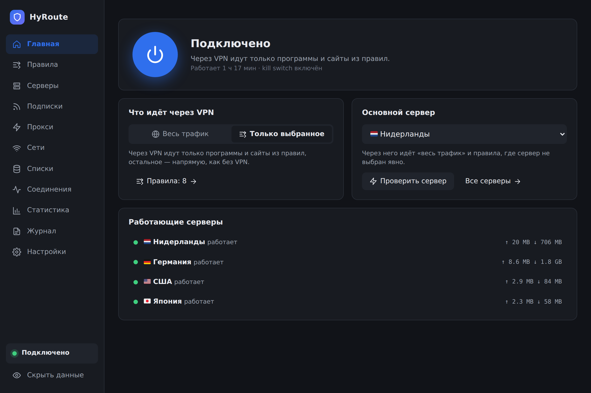
</p>

Программы не нужно настраивать на прокси. HyRoute перехватывает их соединения драйвером WinDivert и разводит по правилам, а до серверов ходит через официальный `hysteria.exe`. YouTube может идти через Германию, ChatGPT через США, Discord через основной сервер, а банки и Госуслуги напрямую — одновременно.

В репозитории две программы:

- **HyRoute** — клиент для Windows. О нём почти весь этот README.
- **[HyRoute Server](#hyroute-server)** — панель для своих серверов Hysteria 2: ставит и настраивает Hysteria на VPS по SSH, следит за ними и выдаёт ссылки для клиентов. Ставится на Linux одной командой.

## Возможности

**Маршрутизация**
- Правила по программам, сайтам, IP, портам и готовым спискам geosite/geoip: каждое на свой сервер, напрямую или в блок. Правило можно сделать прямо из списка соединений или из браузера.
- Импорт правил из SwitchyOmega и ZeroOmega, v2rayN, Xray, Throne, sing-box, FoxyProxy, Clash и PAC-файлов: каждый прокси той программы — на ваш сервер, подбирается по названию.
- Профили правил («Дом», «Работа», «Игры») переключаются на главной и в трее, а «Сети» переключают их сами: дома по Wi-Fi — напрямую, в чужой сети — через VPN.
- DNS по правилам: имена сайтов, которые идут через VPN, разрешаются через тот же сервер, заблокированные не разрешаются вовсе.

**Серверы**
- Несколько серверов одновременно и подписки с автообновлением; остаток трафика и срок подписки видны, а когда они подходят к концу, предупредит главная.
- Группы серверов: HyRoute сам выбирает сервер — самый быстрый, первый работающий, по кругу, случайно или один и тот же для сайта.
- Запасные серверы у каждого правила. Если не работает ни один, соединения не проходят, а не уходят напрямую.
- Локальные прокси SOCKS5 (с UDP) и HTTP для программ, у которых есть настройка прокси.

**Надёжность**
- Kill switch: если HyRoute упал или его закрыли во время подключения, интернет закрыт, пока вы снова не подключитесь.
- Обновления HyRoute и ядра Hysteria с откатом, если новая версия не заработала.
- Резервная копия всех настроек одним файлом: с паролем для паролей и подписок, с планом перед восстановлением и «Вернуть как было».

**Удобство**
- Пошаговая настройка при первом запуске и простой режим с подсказками; всё остальное — в режиме «Для опытных».
- «Проверить адрес» объясняет, какое правило сработает и почему, а «Соединения» — куда что пошло на самом деле.
- Статистика трафика по программам, серверам и группам за день, неделю и месяц. Какие сайты вы открывали, не записывается.
- Расширение для Chrome, Edge, Яндекс Браузера и других: показывает, какие адреса страницы не загрузились, и одной кнопкой отправляет их через VPN, напрямую или в блок.
- Трей, запуск вместе с Windows, автоподключение и командная строка `hyroutectl` для скриптов.

## Установка

Нужны Windows 10 или 11 (64-бит), права администратора и сервер Hysteria 2.

1. Скачайте `HyRoute-<версия>-windows-amd64.zip` со страницы [Releases](https://github.com/lardan099/HyRoute/releases/latest) и распакуйте.
2. Запустите `HyRoute.exe` и разрешите запуск от администратора: без этих прав драйвер перехвата не загрузится.
3. На главной нажмите «Перенести»: HyRoute скопирует себя в `C:\Program Files\HyRoute` и добавит ярлык в «Пуск». Там обычные программы не могут подменить его файлы, а автозапуск работает только оттуда.

`hysteria.exe` и WinDivert лежат в архиве. Если их нет, HyRoute скачает их сам и сверит с контрольными суммами.

## Быстрый старт

При первом запуске HyRoute сам проведёт по шагам: добавит сервер или подписку, проверит его, спросит, что пускать через VPN, и включит. [Как это устроено](docs/GUIDE.md#простой-режим-и-пошаговая-настройка).

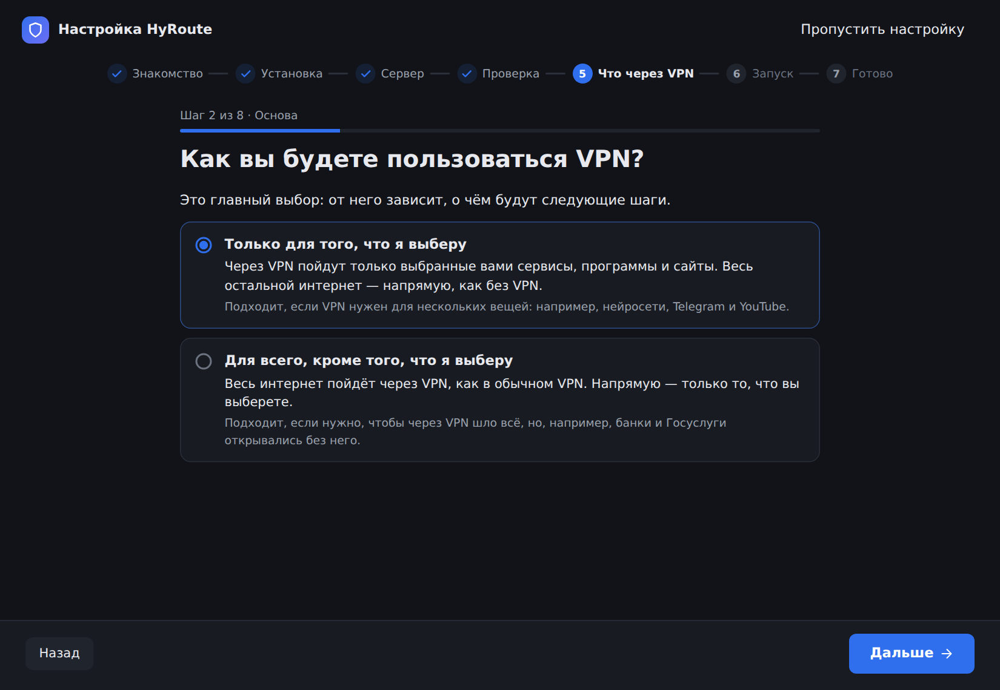

Вручную то же самое:

1. **Серверы** → вставьте ссылку `hysteria2://…` или нажмите «Из буфера обмена». Подписку добавьте на странице «Подписки».
2. **Правила** → «Шаблоны» → выберите схему:
   - «Через VPN только заблокированное» — заблокированное в России через VPN, остальное напрямую;
   - «Всё через VPN, кроме российского» — российские сайты, банки и Госуслуги напрямую, остальное через VPN.
3. **Главная** → кнопка включения.

Правила из SwitchyOmega, v2rayN или другой программы переносятся через «Правила» → «Импорт». Если сайт идёт не туда, откройте «Правила» → «Проверить адрес»: HyRoute покажет, какое правило сработало и почему.

## Как это устроено

Все подробности — в [руководстве](docs/GUIDE.md).

### Правила


Кнопка «Пошагово» собирает правила по шагам с объяснениями: сервисы, программы, сайты, блокировка, серверы. Правила проверяются сверху вниз, срабатывает первое подходящее. Всё, что не подошло ни под одно, идёт по строке «Всё остальное». Правила перетаскиваются мышью и выключаются переключателем.

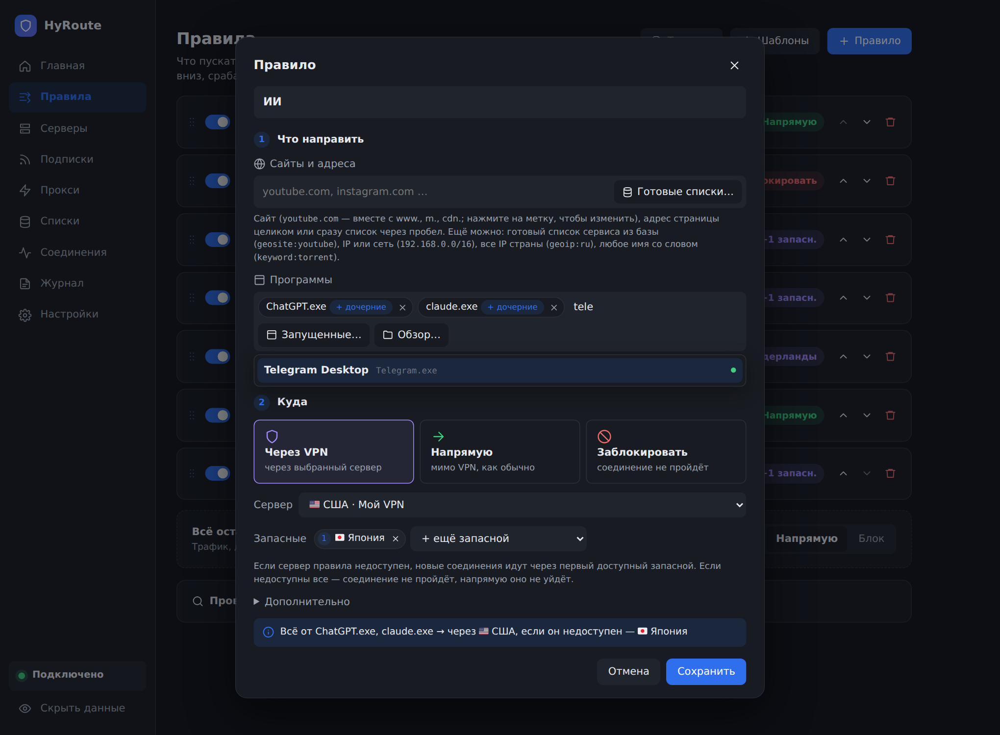

В правиле задаётся, что направлять и куда:

- **Программы.** Начните вводить часть имени — HyRoute подскажет подходящие из запущенных. Правило действует и на процессы, которые программа запускает (лаунчер и игра, браузер и его вкладки).
- **Сайты и адреса.** Домен, IP, сеть или готовый список (`geosite:youtube`, `geoip:ru`). Домен HyRoute узнаёт из DNS, SNI и заголовка Host, поэтому правило на `youtube.com` работает и в браузере, и в приложении.
- **Протокол и порты** (необязательно): `22`, `80, 443` или `27000-27200`, с протоколом TCP или UDP. SSH через один сервер, игра на своих портах через другой; «TCP 22 → напрямую» — правило только по порту.
- **Куда:** основной сервер, выбранный сервер, напрямую или блок. У «через VPN» можно добавить запасные серверы: если сервер правила недоступен, соединения идут через следующий, а если лежат все — не проходят, напрямую не уходят.

### Правила текстом

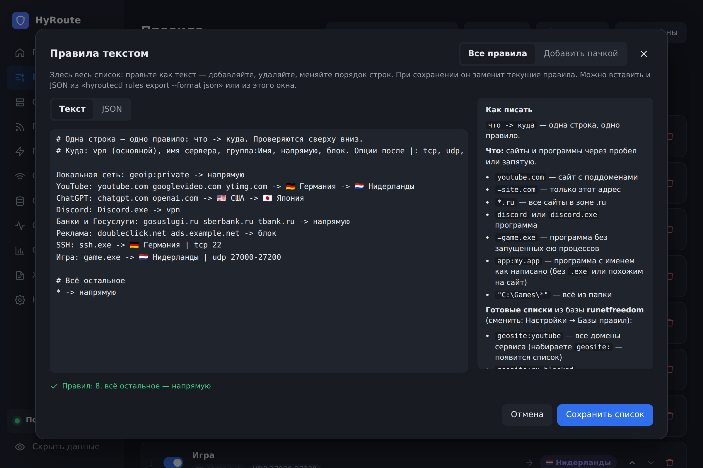

Весь список одним текстом или много правил сразу, одно на строку. Редактор подсказывает серверы, списки и имена запущенных программ. [Полный синтаксис](docs/GUIDE.md#правила-текстом).

```
# что -> куда
Локальная сеть: geoip:private -> напрямую
Заблокированное: geosite:ru-blocked geoip:ru-blocked -> vpn
YouTube: geosite:youtube -> Германия -> Нидерланды
ChatGPT.exe chatgpt.com -> США -> Япония
Реклама: geosite:category-ads-all -> блок
ssh.exe -> Германия | tcp 22
game.exe -> Нидерланды | udp 27000-27200
* -> напрямую
```

### Импорт из других программ

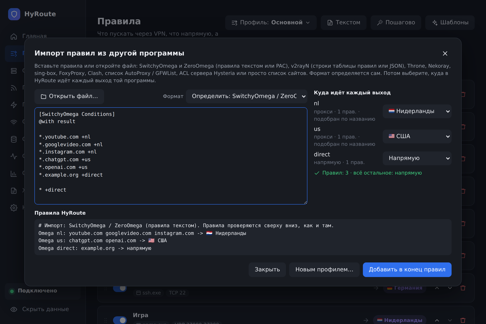

Вставьте правила или откройте файл: резервную копию SwitchyOmega или ZeroOmega, строки v2rayN, JSON Xray, Throne и sing-box, экспорт FoxyProxy, правила Clash, PAC-файл, список AutoProxy или просто список сайтов. Формат определяется сам. Справа — выходы той программы: для каждого выберите сервер, «напрямую» или «блок»; сервер подбирается по названию (`nl` → 🇳🇱, `kazah` → «Казахстан»), выбор запоминается. Правила добавляются в конец списка или становятся отдельным профилем правил, порядок сохраняется. Что перенести нельзя (правила по пути страницы, `bittorrent` и т. п.), окно называет по строкам. [Подробнее](docs/GUIDE.md#импорт-правил-из-других-программ).

### Профили правил и сети

Несколько наборов правил — «Дом», «Работа», «Игры» — переключаются на главной, на странице «Правила» и в меню трея. Страница «Сети» делает это сама: дома по своему Wi-Fi можно отключаться или включать домашний профиль, в чужой сети — подключаться через VPN. [Подробнее](docs/GUIDE.md#сети).

### Серверы и подписки

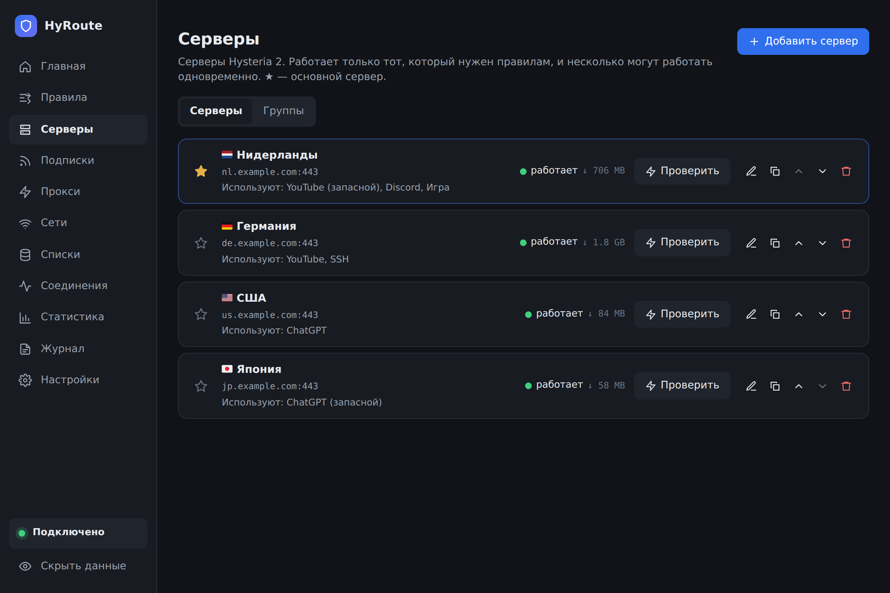

Серверы добавляются ссылками `hysteria2://` и `hy2://`, по одной или пачкой, или вручную: obfs salamander, закрепление сертификата, порт-хоппинг. HyRoute запускает только те серверы, которые нужны правилам и прокси, и перезапускает упавшие. «Проверить» показывает подключение, внешний IP, задержку и работу UDP. Основной сервер отмечен звёздочкой. Несколько серверов можно собрать в группу, и она будет выбирать сервер сама.

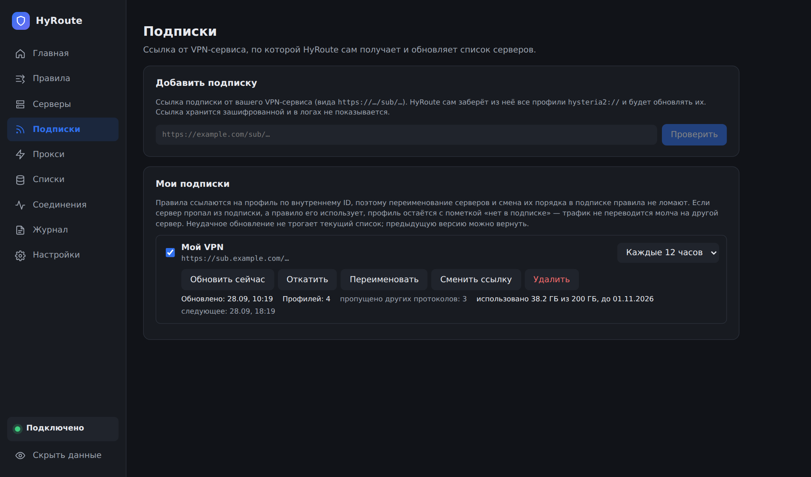

Подписка обновляется по расписанию, каждое обновление можно откатить. Если сервис сообщает остаток трафика и срок (3x-ui, Marzban, Remnawave и другие панели), они видны у подписки, а когда подходят к концу, главная предупредит. Серверы других протоколов (VLESS, VMess и т. д.) пропускаются. Если сервер исчез из подписки, а правило на него ссылается, HyRoute пометит его и попросит выбрать замену.

**Группы** («Серверы» → «Группы») — несколько серверов под одним именем. Группа выбирает сервер для каждого соединения сама: первый работающий, самый быстрый, по кругу, случайно или один и тот же для сайта. Группу можно указать везде, где выбирается сервер.

### Локальные прокси

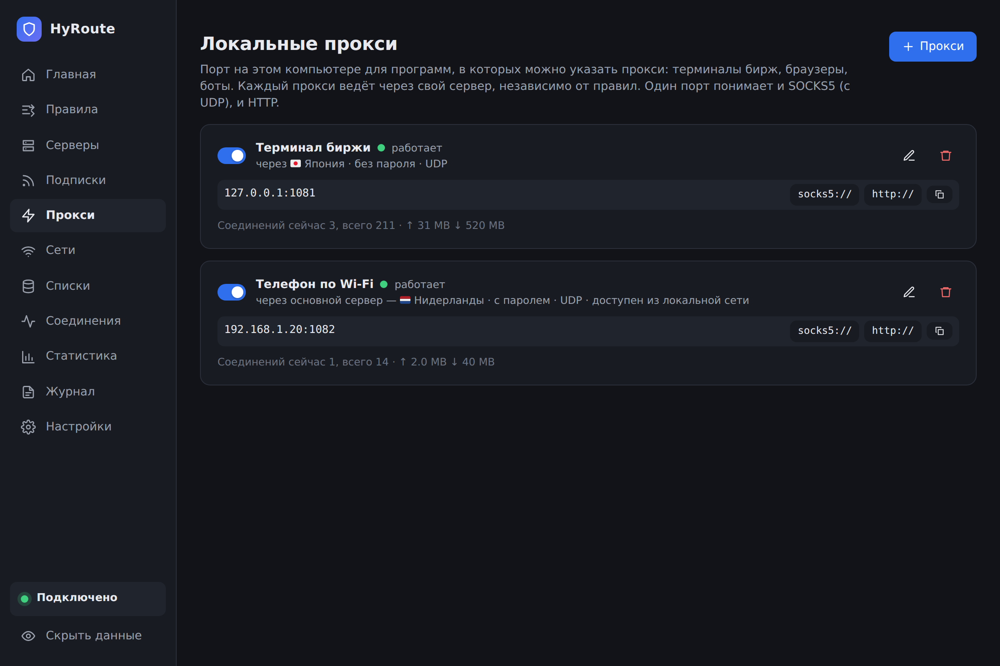

Порт на этом компьютере для программ с настройкой прокси: терминалов бирж, браузеров, ботов. Каждый прокси ведёт через свой сервер независимо от правил. Один порт принимает и SOCKS5 (вместе с UDP), и HTTP, логин и пароль по желанию. Доступ из локальной сети — только с паролем, UDP для него включается отдельно.

### Готовые списки

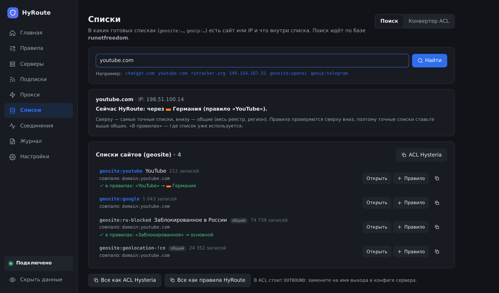

`geosite:…` и `geoip:…` берутся из тех же баз, что в v2rayN и Xray: runetfreedom (по умолчанию, с `ru-blocked`), Loyalsoldier, v2fly, hysteria-geodata или свои ссылки. HyRoute скачивает их, только когда они нужны правилам, и обновляет раз в 12 часов. Страница «Списки» отвечает, в каких списках есть сайт или IP и что HyRoute с ним делает сейчас, а «Конвертер» переводит ACL сервера Hysteria в правила.

### Соединения

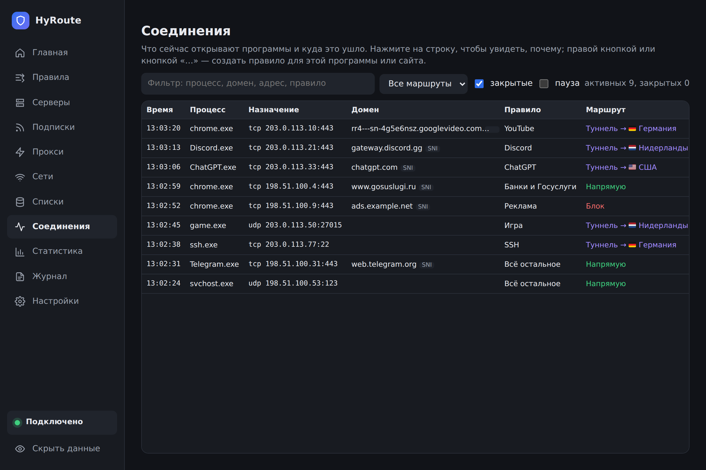

Какая программа куда подключилась, по какому правилу и через какой сервер. Щелчок по строке объясняет, почему соединение пошло именно так, а правая кнопка (или «…» в конце строки) создаёт правило для сайта, адреса или программы: оно встаёт прямо над правилом, которое решает это соединение сейчас, и его можно отменить из сообщения. То же меню есть у строк DNS-запросов: правило по имени, которое спрашивали.

### Расширение для браузера

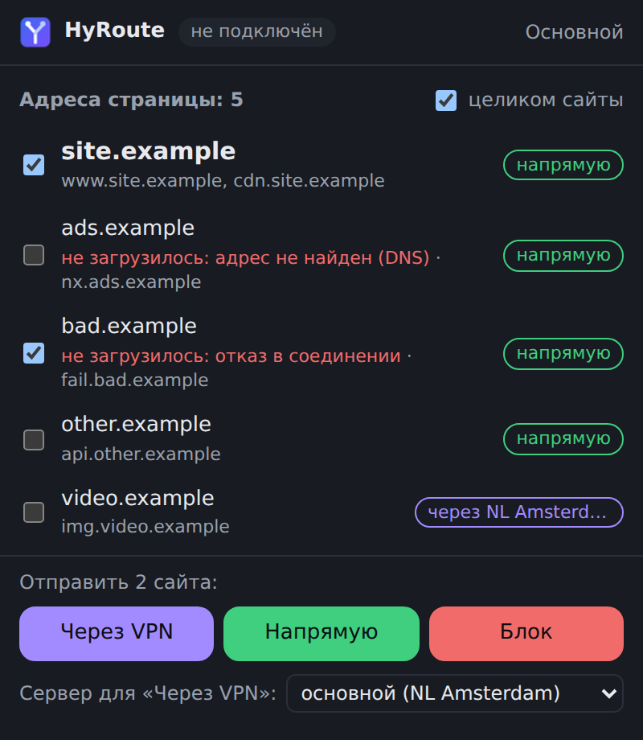

Кнопка HyRoute в Chrome, Edge, Яндекс Браузере, Brave, Opera и Vivaldi. На открытой странице она показывает все адреса, с которых страница что-то загружала, отмечает те, что не загрузились, и как HyRoute отправляет каждый сейчас. Отметьте нужные и нажмите «Через VPN» (основной или выбранный сервер), «Напрямую» или «Блок» — сайты попадут в правила «Из браузера: …» в начале списка. Расширение не из магазина: «Настройки» → «Расширение для браузера» → «Установить в браузер», затем один раз перетащить папку на страницу расширений браузера. С HyRoute оно говорит через `hyroutectl.exe`, без открытых портов. [Подробнее](docs/GUIDE.md#расширение-для-браузера).

### Статистика

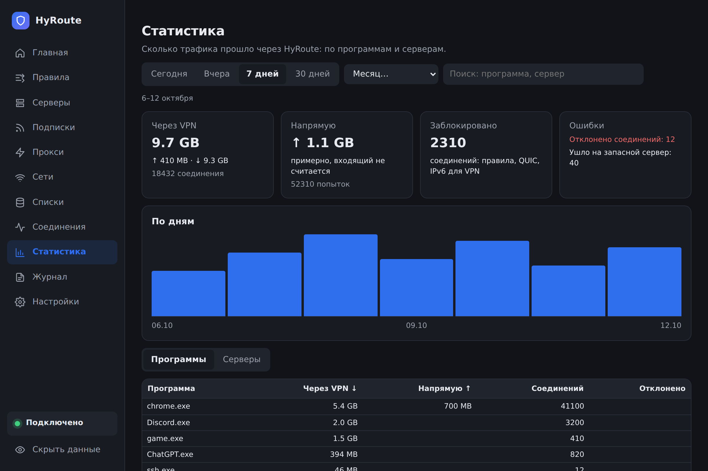

Сколько трафика прошло через VPN и напрямую за сегодня, вчера, 7 и 30 дней или любой месяц — по программам, серверам и группам, с числом соединений, блокировок и ошибок (отклонённые соединения, уход на запасной сервер). Хранится только на этом компьютере; какие сайты вы открывали, не записывается.

### DNS по правилам

«Настройки» → «DNS» (выключено по умолчанию): имена сайтов, которые идут через VPN, разрешаются через тот же сервер, заблокированные сразу получают отказ, а прямые запросы можно шифровать (Cloudflare, Google, Quad9, AdGuard, Яндекс или свой DoH/DoT). «Не давать браузерам обходить DNS» и «Отключать ECH» помогают правилам для сайтов срабатывать и в браузерах со встроенным «безопасным DNS».

### Kill switch

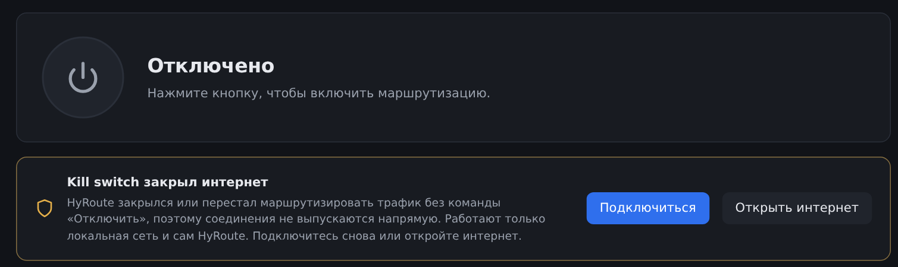

Если HyRoute закрылся во время подключения (окно закрыто, «Снять задачу», сбой) или отказал драйвер перехвата, Windows закрывает интернет, пока вы снова не подключитесь или не нажмёте «Открыть интернет». Если отказал движок, HyRoute переподключается сам. Если блокировка осталась после выключения ПК, HyRoute сам покажет её при входе в Windows. [Подробнее](docs/GUIDE.md#kill-switch).

### Запуск и трей

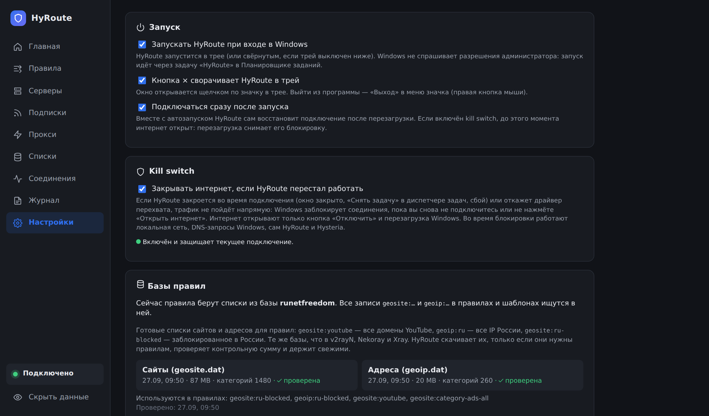

- **Запуск при входе в Windows** — без запроса прав администратора, у каждого пользователя свой.
- **Крестик сворачивает в трей.** Окно при этом закрывается целиком, вместе с WebView2, и не занимает память; HyRoute работает дальше. Щелчок по значку открывает окно, правая кнопка — меню с подключением и выходом. Значок цветной, когда HyRoute подключён.
- **Подключаться сразу после запуска** — вместе с автозапуском возвращает подключение, kill switch и прокси после перезагрузки.

Ещё: журнал без паролей, диагностика, режим «Скрыть данные» для скриншотов, темы.

## Что HyRoute делает на компьютере

- **Права администратора** нужны драйверу WinDivert. Трафик перехватывается, только пока HyRoute подключён; после отключения, закрытия или сбоя трафик идёт так, как шёл бы без HyRoute (если не включён kill switch).
- **Kill switch и автозапуск** — фильтры WFP и задачи Планировщика заданий, только если вы их включили. Для relay и локальных прокси HyRoute добавляет правила брандмауэра Windows.
- **Расширение для браузера** — только если вы его установили: папка `browser-extension` рядом с HyRoute и ключи `NativeMessagingHosts` в реестре вашей учётной записи, чтобы браузер мог запускать `hyroutectl.exe`. «Удалить связь с браузерами» убирает и то, и другое.
- **`hysteria.exe` и WinDivert** запускаются только из папки, куда могут писать одни администраторы. Копии из архива сверяются с SHA-256, зашитыми в сборку; обновлённое ядро Hysteria — с `hashes.txt` своего выпуска и дайджестом GitHub при установке, а перед каждым запуском — с хешем, записанным тогда. Обновление HyRoute сверяется с `SHA256SUMS` своего выпуска.
- **Данные** лежат в `%APPDATA%\HyRoute` и `%ProgramData%\HyRoute`. Пароли серверов и ссылки подписок зашифрованы под вашей учётной записью Windows и не пишутся в журнал. Статистика хранится только на этом компьютере.
- **Сам HyRoute ходит в сеть** к вашим серверам и подпискам и на GitHub: за обновлениями HyRoute и Hysteria (раз в 12 часов или только по кнопке), за базами geosite/geoip, если они нужны правилам (источник можно сменить), и за `hysteria.exe` с WinDivert, если их нет рядом. Ещё — к сервисам внешнего IP при «Проверить» и к адресу проверки задержки у групп, оба раза через ваш сервер, и к выбранному DoH, если вы включили шифрование DNS. Телеметрии нет.

Как удалить HyRoute начисто — в [руководстве](docs/GUIDE.md#удаление).

## Ограничения

- Без «DNS по правилам» DNS-запросы Windows идут напрямую; зашифрованный DNS самой Windows (DoH/DoT в параметрах сети) HyRoute не видит.
- Если браузер использует свой DoH и сайт скрывает имя через ECH, домен неизвестен: срабатывают правила по IP, по программе или «Всё остальное». Помогают «Не давать браузерам обходить DNS» и «Отключать ECH».
- Если в правилах есть сайты (без указания программы), HTTPS-соединения проходят через HyRoute, пока он не прочтёт имя сайта, в том числе те, что потом идут напрямую. На больших загрузках это может замедлять их и нагружать процессор. «Настройки» → «Маршрутизация» → «Точное определение сайта» (режим «Для опытных»): без него HyRoute решает по DNS, где это однозначно, и такие соединения идут мимо него.
- При подключении уже открытые соединения программ и адресов, которые по правилам идут через VPN, один раз сбрасываются и открываются заново через туннель. Домены уже открытых соединений HyRoute не знает: соединение с сайтом из правила «через VPN», когда «Всё остальное» идёт напрямую, продолжает идти напрямую, пока программа не переподключится.
- UDP-датаграммы больше примерно 4 КБ (предел самой Hysteria) через VPN не проходят. Датаграммы, разбитые на IP-фрагменты, HyRoute собирает и отправляет через VPN целиком.
- Программа не подписана сертификатом разработчика: SmartScreen может предупредить при первом запуске.
- Античиты Vanguard и FACEIT (иногда EAC) не пускают в игру, пока загружен WinDivert. Часть антивирусов блокирует WinDivert.
- Поддерживается только Hysteria 2. Расширение — только для браузеров на Chromium: Firefox нужен подписанный пакет.

Полный список — в [руководстве](docs/GUIDE.md#ограничения).

## HyRoute Server

Панель для тех, кто держит свои серверы Hysteria 2. Одна программа `hyroute-server` с веб-интерфейсом работает на вашем компьютере, домашнем сервере или отдельном VPS и управляет серверами по SSH. На самих серверах, кроме Hysteria, ничего не ставится. Управляемые серверы — Linux с systemd (Debian, Ubuntu и похожие).

- **Развёртывание и импорт.** Новый сервер ставится с проверкой перед установкой, порт-хоппингом, Salamander, сертификатом Let's Encrypt или самоподписанным и пресетами настроек. Уже работающий сервер панель берёт под управление, ничего на нём не меняя.
- **Конфиг с откатом.** Редактор показывает разницу с текущим конфигом, применяет его и сам возвращает прежний, если Hysteria с новым не поднялась. Каждая версия сохраняется, к любой можно вернуться. Правки, сделанные на сервере вручную, панель находит и предлагает принять или вернуть.
- **Состояние.** Служба, журнал Hysteria, нагрузка, трафик по пользователям, проверки здоровья. События и оповещения приходят в Telegram, на вебхук или почту.
- **Клиенты.** Пользователи Hysteria на сервере, ссылки `hysteria2://` и QR-коды для HyRoute и других клиентов.
- **Каскады** до четырёх серверов: вход в России, выход за границей. Маршрутизация на сервере собирается «По сервисам»: YouTube — через выход, Госуслуги — напрямую.
- **Много серверов.** Массовые операции: сначала на одном сервере, потом на остальных. Обновление Hysteria, ротация паролей и сертификатов.
- **Команда.** Пользователи панели с ролями (от владельца до «только чтение») и областью по меткам серверов, журнал аудита.
- **Сохранность.** Пароли и ключи SSH зашифрованы мастер-ключом, незнакомый ключ SSH сервера без вашего подтверждения не принимается. Произвольных команд на сервере панель не выполняет, только свои операции. Есть резервные копии базы и диагностический пакет без секретов.

Установка и обновление на Linux с systemd (x86_64 или arm64):

```sh
curl -fsSL https://github.com/lardan099/HyRoute/releases/latest/download/install-server.sh | sudo sh
```

Скрипт сверяет сборку с контрольными суммами релиза, ставит службу и в конце пишет код первого запуска и команду SSH-туннеля. Сборка для Windows лежит в релизе. По умолчанию панель видна только с этой машины: снаружи до неё добираются через SSH-туннель или обратный прокси с TLS. Всё проверено тестами, в том числе каскад из трёх узлов по SSH, но на живых серверах панель ещё не обкатана. [Установка, доступ, роли, каскады и всё остальное](docs/SERVER_MANAGER.md).

## Документация

- [Руководство](docs/GUIDE.md) — все страницы и настройки, синтаксис правил, где лежат данные.
- [Архитектура](docs/ARCHITECTURE.md) — как устроен перехват, правила, DNS и поведение при отказах.
- [HyRoute Server](docs/SERVER_MANAGER.md) — руководство по панели, [её архитектура](docs/SERVER_MANAGER_ARCHITECTURE.md).
- [Что нового](https://github.com/lardan099/HyRoute/releases) — заметки к выпускам.
- [Безопасность](SECURITY.md) — как сообщить об уязвимости. Ошибки и предложения — в [Issues](https://github.com/lardan099/HyRoute/issues).

## Сборка

Нужны Go 1.27 и PowerShell. Node.js нужен только для изменений в интерфейсе: собранный интерфейс лежит в репозитории.

```powershell
.\scripts\build.ps1            # -Frontend, чтобы пересобрать интерфейс; собирает и hyroutectl.exe
.\bin\HyRoute.exe
.\bin\hyroutectl.exe --help
```

Тесты: `go test ./...`, работают и на Linux. Код:

- `cmd/` — `HyRoute.exe`, `hyroutectl.exe`, программа обновления и `hyroute-server`;
- `internal/` — всё остальное на Go, панель — в `internal/srvmgr/`;
- `frontend/` — интерфейс клиента на Svelte, `web/admin/` — интерфейс панели;
- `browser/` — расширение для браузера.

## Лицензия

[MIT](LICENSE). Сторонние компоненты и их лицензии перечислены в [`THIRD-PARTY-NOTICES.txt`](THIRD-PARTY-NOTICES.txt).
